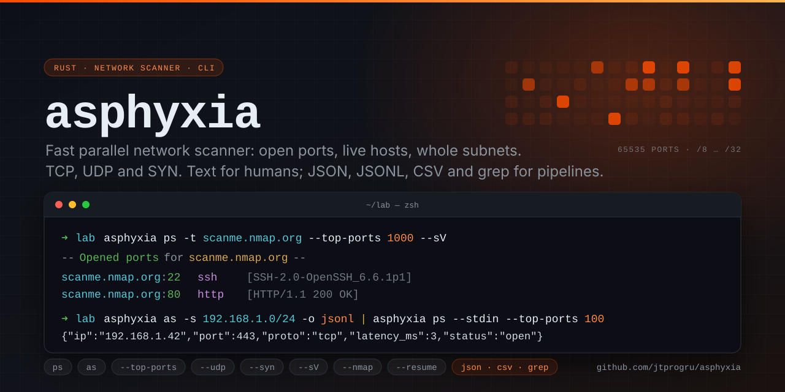

# Asphyxia

[](https://github.com/jtprogru/asphyxia/actions/workflows/ci.yml)
[](https://github.com/jtprogru/asphyxia/actions/workflows/rust-release.yml)
[](https://crates.io/crates/asphyxia)
[](https://docs.rs/asphyxia)
[](https://crates.io/crates/asphyxia)
[](https://www.rust-lang.org)
[](LICENSE)

<p align="center">
  
</p>

A fast and efficient network scanner written in Rust.

## Description

Asphyxia is a command-line network scanner that helps you discover open ports on a host and find reachable hosts on a network. It runs scans in parallel for speed and shows live progress while it works.

## Features

- **Port scanning** — scan a range of ports, a specific comma-separated list, the entire port range (`--all-ports`), the N most common ports (`--top-ports`), or a named port set (`--ports web`) on a target host.
- **Address scanning** — check a single IP, scan an IP range, or scan an entire subnet (CIDR).
- **ARP host discovery** — `as --discovery arp` finds hosts on a locally-connected IPv4 subnet by ARP, including hosts that silently drop every TCP probe; it reports the MAC address and vendor OUI and falls back to TCP for remote or IPv6 targets.
- **ICMP ping sweep** — `as --discovery icmp` sends ICMP echo requests to routed IPv4 hosts and reports those that answer, without needing libpcap.
- **Combined discovery** — `--discovery arp,icmp,tcp` tries several probes per host (or `auto` for ARP → ICMP → TCP), names the probe that confirmed each host, and degrades unavailable probes to warnings instead of failing the scan.
- **Reverse DNS / PTR** — `as --resolve-ptr` adds a PTR name and a separate forward-confirmed verdict for each live host, with a bounded lookup that never fails the base scan.
- **Device classification** — `--classify` labels an asset (`windows`, `printer`, `hypervisor`, `network-device`, `web-server`, or `unknown`) with a confidence, using only ports/banners already collected and the ARP OUI; it never probes again.
- **Offline ASN / cloud hints** — `--asn` adds `asn`, `asn_org` and `cloud` from a bundled prefix table, with no DNS or API requests and no target IP leaving the machine.
- **Chainable scans** — pipe the hosts an address scan discovers straight into a port scan with `--stdin`, turning host discovery and port scanning into a single pipeline.
- **IPv4 and IPv6** — connect and UDP scans accept both address families; raw TCP and ARP modes are IPv4-only and fall back visibly for IPv6.
- **Configurable timeout** — tune the per-connection timeout with `--timeout`.
- **Parallel execution** — scans run concurrently via [rayon](https://crates.io/crates/rayon), with tunable concurrency (`--concurrency`) for large subnet scans.
- **Live progress bars** — long-running scans show real-time progress.
- **Colorized output** — readable, colored terminal output.
- **Machine-readable output** — emit results as JSON, JSON Lines, CSV, or greppable text with `--output`, and write them straight to a file with `--output-file`, for piping into other tools.

- **Target sources** — scan a single host, pipe targets in with `--stdin`, or read them from a file with `-i/--target-file`; hosts, IPs, and CIDRs are all accepted, and CIDRs in a file are expanded.
- **Configuration file** — set defaults (timeout, concurrency, retries, output format, bind interface) in `~/.asphyxia.toml`; command-line flags override it.
- **Resumable scans** — checkpoint a long port scan with `--resume <file>` and pick it up where it stopped after a Ctrl-C, crash, or dropped link.
- **SYN/stealth scan** — half-open SYN scanning with `--syn` (IPv4, needs privileges): SYNs are sent over a raw socket and replies captured with libpcap/BPF, so it works the same on macOS and Linux, with automatic fallback to the connect scan.
- **ACK scan** — `--scan ack` maps the firewall instead of the services: it reports which ports a filtering device lets through (`unfiltered`) and which it swallows (`filtered`), over the same raw-socket/pcap path and the same automatic fallback.
- **FIN / NULL / XMAS scans** — `--scan fin|null|xmas` send SYN-less probes (a lone FIN, no flags at all, or FIN+PSH+URG): per RFC 793 a closed port answers with an RST while an open one drops the segment silently, so results are `closed` or the honest `open|filtered`, over the same raw-socket/pcap path and fallback.
- **Interface binding** — pin every probe to a specific network interface with `-e/--interface` (like `ssh -B` or `nmap -e`), so a host reachable only through a VPN, tunnel, or a more specific route is scanned over the right link instead of the default route.

> Note: IPv6 subnet and range scans are capped at 65 536 addresses (e.g. a `/112`), since larger IPv6 spaces are impractical to walk exhaustively.

## Installation

### Homebrew (macOS & Linux)

```bash
brew tap jtprogru/tap
brew install jtprogru/tap/asphyxia
```

The formula is published automatically to the [jtprogru/homebrew-tap](https://github.com/jtprogru/homebrew-tap) tap on every release and supports macOS (Apple Silicon & Intel) and Linux (x86_64 & arm64).

### Cargo

Install the latest published release from [crates.io](https://crates.io/crates/asphyxia):

```bash
cargo install asphyxia
```

Or install the current `main` branch straight from the repository:

```bash
cargo install --git https://github.com/jtprogru/asphyxia
```

### Prebuilt binaries

Download the archive for your platform from the [latest release](https://github.com/jtprogru/asphyxia/releases/latest), unzip it, and place the `asphyxia` binary somewhere on your `PATH`. Builds are provided for:

- Linux (glibc): `x86_64`, `aarch64`
- Linux (musl, static): `x86_64`, `aarch64`
- macOS: `aarch64` (Apple Silicon), `x86_64` (Intel)

The glibc archives are built on Ubuntu 24.04 and need glibc 2.39 or newer. On an older distribution — or on Alpine and other musl systems — take the `*-linux-musl` archive instead: it is statically linked, libpcap included, and needs nothing from the host.

Each archive is shipped with a detached GPG signature (`.asc`). After importing the signing key you can verify an archive with:

```bash
gpg --verify asphyxia-<target>.zip.asc asphyxia-<target>.zip
```

### Building from source

Requires Rust 1.88 or newer (the project uses the 2024 edition) and libpcap development headers for the SYN-scan reply capture. libpcap ships with macOS; on Linux install it first (`sudo apt-get install libpcap-dev` on Debian/Ubuntu, `sudo apk add libpcap-dev` on Alpine, `sudo pacman -S libpcap` on Arch).

```bash
git clone https://github.com/jtprogru/asphyxia.git
cd asphyxia
cargo build --release
```

The compiled binary will be available at `target/release/asphyxia`.

## Usage

Asphyxia exposes two subcommands: `ps` (port scan) and `as` (address scan).

```bash
asphyxia --help        # general help
asphyxia ps --help     # port scan options
asphyxia as --help     # address scan options
```

### Port scanning (`ps`)

```bash
# Scan a range of ports (start end)
asphyxia ps -t example.com -r 80 443

# Scan specific ports (comma-separated)
asphyxia ps -t example.com -s 22,80,443,8080

# Scan every port (1-65535)
asphyxia ps -t example.com --all-ports

# Scan the N most common TCP ports (frequency-ordered, no manual list)
asphyxia ps -t example.com --top-ports 100
asphyxia ps -t example.com --top-ports 1000

# Scan UDP ports instead of TCP (DNS, NTP, SNMP, …) — service probes elicit real replies
asphyxia ps -t example.com -s 53,123,161 --udp

# Probe a specific UDP service with its protocol payload (DNS query, NTP request, SNMP GET)
asphyxia ps -t resolver.example.com -s 53 --udp --retries 1

# SYN/stealth scan via raw sockets (needs root/CAP_NET_RAW)
sudo asphyxia ps -t example.com --top-ports 1000 --syn

# ACK scan: which ports the firewall lets through (unfiltered) or blocks (filtered)
sudo asphyxia ps -t example.com --top-ports 100 --scan ack

# FIN / NULL / XMAS stealth scans: closed, or open|filtered when silent
sudo asphyxia ps -t example.com --top-ports 100 --scan fin
sudo asphyxia ps -t example.com --top-ports 100 --scan null
sudo asphyxia ps -t example.com --top-ports 100 --scan xmas

# Grab banners and identify services on open ports
asphyxia ps -t example.com -s 22,80,443 --sV

# Scan a named port set (web, mail, db, remote, windows)
asphyxia ps -t example.com --ports web

# Drop specific ports from the set, and spare known CDN/WAF targets (80/443 only)
asphyxia ps -t example.com --top-ports 1000 --exclude-ports 9100,631
asphyxia ps --stdin --top-ports 1000 --exclude-cdn < hosts.txt

# Find open ports fast, then hand them to nmap for a deep dive
asphyxia ps -t scanme.nmap.org --top-ports 100 --nmap
asphyxia ps -t scanme.nmap.org --top-ports 100 --nmap --nmap-args "-A -T4"

# Scan an IPv6 host with a shorter timeout
asphyxia ps -t 2001:db8::1 -s 22,80,443 --timeout 500

# Read targets from stdin instead of -t (one host per line, or JSON/JSONL from `as`)
asphyxia ps --stdin -s 22,80,443 < hosts.txt

# Read targets from a file (hosts, IPs, or CIDRs; CIDRs are expanded)
asphyxia ps -i targets.txt --top-ports 100
```

Exactly one target source is required — `-t/--host`, `--stdin`, or `-i/--target-file` — and they are mutually exclusive. Likewise `-r`, `-s`, `--all-ports`, `--top-ports`, and `--ports` are mutually exclusive.

| Flag | Description |
|------|-------------|
| `-t, --host <HOST>` | Target host (hostname, IPv4, or IPv6) |
| `--stdin` | Read targets from stdin instead of `-t`: one host per line, or the JSON/JSONL emitted by `asphyxia as -o` (the `ip` field is used) |
| `-i, --target-file <PATH>` (`--iL`) | Read targets from a file: hosts, IPs, CIDRs (expanded), or `as` JSON/JSONL, one per line |
| `-r, --range <START> <END>` | Scan an inclusive range of ports |
| `-s, --specific <PORTS>` | Scan specific comma-separated ports |
| `-a, --all-ports` | Scan the entire port range (1-65535) |
| `-u, --udp` | Scan UDP ports instead of TCP (results are `open` or `open\|filtered`) |
| `--syn` | SYN/stealth scan via raw sockets (IPv4; needs root/`CAP_NET_RAW`, else falls back to connect) |
| `--scan <MODE>` | Probe type: `connect` (default), `syn`, `ack` (firewall state), or `fin`/`null`/`xmas` (stealth; closed or open\|filtered). Raw modes need root, else fall back to connect |
| `--sV` (`--banner`) | Grab banners and identify the service on each open TCP port |
| `--classify` | Infer a coarse device type and confidence from already-collected ports/banners (no new probes) |
| `--asn` | Add offline `asn`, `asn_org` and `cloud` hints from the bundled prefix table; no network requests |
| `--resume <PATH>` | Checkpoint progress to a file and resume from it if it already exists |
| `--top-ports <N>` | Scan the `N` most common TCP ports (frequency-ordered, up to 1000) |
| `--ports <NAME>` | Scan a named port set: `web`, `mail`, `db`, `remote`, `windows` |
| `--exclude-ports <PORTS>` | Remove these comma-separated ports from the scan set |
| `--exclude-cdn` | For known CDN/WAF targets, scan only 80 and 443 instead of the full set |
| `--nmap` | After the scan, run nmap on each host's open ports for a deep dive |
| `--nmap-args <ARGS>` | Custom nmap arguments (replace the default `-sV -sC`); implies `--nmap` |
| `--source-port <PORT>` | Fixed source port for raw TCP probes (raw modes only; ignored with a warning in connect/UDP scans) — useful for testing firewall rules keyed on source port |
| `--delay <MS>` | Minimum delay between probes, in milliseconds. Combined with `--jitter`, each probe's interval is randomized within ±PCT of this value |
| `--jitter <PCT>` | Jitter as a percentage (0–100) of `--delay`, randomizing each probe's interval within ±PCT. Requires `--delay` |
| `--timeout <MS>` | Per-connection timeout in milliseconds (default: 2000) |
| `-e, --interface <NAME>` (`--iface`) | Bind every probe to this network interface (e.g. `en0`), like `ssh -B` / `nmap -e` |
| `-c, --concurrency <N>` | Maximum concurrent connection attempts (default: 256) |
| `--retries <N>` | Extra retries per probe on no answer/timeout (default: 0); refused ports are never retried |
| `--rate <PPS>` | Cap connection attempts per second across the whole scan (0 or unset: no cap) |
| `-T, --timing <0-5>` | Timing profile from `0` (paranoid) to `5` (insane), presetting timeout/concurrency/retries/rate |
| `-o, --output <FORMAT>` | Output format: `text` (default), `json`, `jsonl`, `csv`, or `grep` |
| `--output-file <PATH>` (`--oF`) | Write machine-readable output to a file instead of stdout |

#### UDP scanning (`--udp`)

Pass `-u`/`--udp` to probe UDP ports instead of TCP. UDP has no handshake, so results are inherently less certain than TCP and use four states:

- **`open`** — the port sent a reply. For a few well-known ports asphyxia sends a protocol-specific probe (a DNS query on 53, an NTP client request on 123, an SNMP GET on 161) to coax a reply and turn what would otherwise be a guess into a definite `open`.
- **`closed`** — an ICMP port-unreachable (type 3, code 3) came back; the host has no service on that port.
- **`filtered`** — another ICMP unreachable (type 3 codes 1/2/9/10/13) says a device dropped the probe, so the state behind it is unknown.
- **`open|filtered`** — the port stayed silent within the timeout. The datagram may have been dropped, the service may not answer this particular probe, or a firewall may be filtering it — these are indistinguishable without elevated privileges.

Every probed UDP port is reported, including `closed` and `filtered`, because silence and ICMP answers are results too. In machine output the `proto` field is `"udp"` and `status` is one of `open`, `closed`, `filtered`, or `open|filtered`. Because silent ports wait out the full `--timeout`, UDP scans of many ports are slower than TCP — narrow the port set (e.g. `-s 53,123,161,500` or `--top-ports`) and consider `--retries 1` on a lossy link.

```bash
asphyxia ps -t 192.168.1.1 -s 53,123,161 --udp
asphyxia ps -t 192.168.1.1 -s 53,123,161 --udp -o jsonl
# {"ip":"192.168.1.1","port":53,"proto":"udp","scan":"connect","latency_ms":4,"status":"open"}
```

#### Service & version detection (`--sV`)

Add `--sV` (alias `--banner`) to identify what is listening on each open TCP port. For every open port asphyxia grabs a small banner — reading whatever the service announces on connect (SSH, SMTP, FTP), and nudging quiet services with a minimal HTTP request — then matches it against a compact set of built-in signatures (SSH, HTTP, SMTP, FTP, POP3/IMAP, MySQL, Redis, …). When no banner can be matched it falls back to the well-known name for the port.

This is a lightweight identifier, not a full nmap-service-probes database — for exhaustive detection, combine it with `--nmap`. In machine output the `service` and `banner` fields are added to each record (omitted when nothing was found); in text output they are shown next to the port.

```bash
asphyxia ps -t example.com -s 22,80,443 --sV
asphyxia ps -t example.com --top-ports 100 --sV -o jsonl
# {"ip":"93.184.216.34","port":22,"proto":"tcp","scan":"connect","latency_ms":7,"status":"open","service":"ssh","banner":"SSH-2.0-OpenSSH_9.6"}
```

#### SYN / stealth scan (`--syn`)

`--syn` performs a half-open SYN scan: it sends a lone TCP SYN and never completes the handshake — a SYN/ACK means open, an RST means closed, silence means filtered. This is faster and quieter than the default connect scan, at the cost of needing elevated privileges. The SYN is forged and sent over a raw socket, and replies are read with libpcap/BPF through a single shared capture — the same approach nmap uses, and the reason it works the same on macOS and Linux.

```bash
sudo asphyxia ps -t scanme.nmap.org --top-ports 1000 --syn
```

Details and limitations:

- **Privileges** — forging raw packets and capturing replies requires root or `CAP_NET_RAW`. Without them, asphyxia prints a notice and automatically falls back to the connect scan, so the command still works unprivileged (just not stealthily).
- **libpcap** — the reply capture uses libpcap. It is present by default on macOS; on Linux install `libpcap` (e.g. `libpcap-dev`/`libpcap0.8` on Debian/Ubuntu, `libpcap` on Alpine/Arch). The static musl release builds already carry libpcap, so they need no such package. If the capture can't be opened, asphyxia warns and falls back to the connect scan.
- **IPv4 only** — IPv6 targets always use the connect scan.
- **Correctness fallback** — a port that a SYN probe reports as *filtered* (no reply) is re-checked with a connect probe, so an open port is never missed if a reply is lost. Definitive open/closed SYN results are used directly.
- **High-latency links** — a SYN probe waits up to `--timeout` for its reply. On slow paths (distant hosts, VPNs) a reply can arrive just after the deadline and the probe then falls back to a connect check (still correct, just not stealthy). Raise `--timeout` on such links so SYN replies land in time.
- **Diagnostics** — set `ASPHYXIA_SYN_DEBUG=1` to print capture diagnostics to stderr (the chosen interface and datalink, each captured reply, and each probe's outcome), useful when a scan unexpectedly falls back.
- **Fixed source port (`--source-port <PORT>`)** — every raw probe carries the given port as its TCP source, so firewall rules keyed on source port (e.g. an ACL allowing egress from 53/80/443) can be tested directly. Without it, each probe forges a distinct ephemeral source port per scanned port. With a fixed source port, replies are attributed by their destination port (the scanned port) rather than their own source, since every probe now carries the same source. The flag applies to raw scans only; in connect/UDP mode it is ignored with a warning.
- `--syn` and `--udp` are mutually exclusive.

#### ACK scan (`--scan ack`)

`--scan ack` sends a lone TCP ACK instead of a SYN. Any reachable host answers a stray ACK with an RST whether the port is open or closed, so the reply says nothing about the service behind it — only that the probe got through. That makes it a map of the **firewall**, not of the services:

- **`unfiltered`** — an RST came back, so nothing dropped the probe on the way in. The port may be open or closed; an ACK probe cannot tell, and Asphyxia does not guess.
- **`filtered`** — silence within `--timeout`. A stateful firewall or ACL swallowed the probe.

Use it to see which ports a filtering device passes, then re-scan those with `--syn` or a connect scan to learn what is actually listening.

```bash
sudo asphyxia ps -t gateway.example.com --top-ports 100 --scan ack
sudo asphyxia ps -t gateway.example.com --top-ports 100 --scan ack -o jsonl
# {"ip":"192.0.2.1","port":22,"proto":"tcp","scan":"ack","latency_ms":6,"status":"unfiltered"}
# {"ip":"192.0.2.1","port":23,"proto":"tcp","scan":"ack","latency_ms":2000,"status":"filtered"}
```

Details and limitations:

- **Every probed port is reported**, unlike the other modes, which list only what they found: with an ACK scan silence *is* the finding, so `filtered` ports are results too. Keep the port set narrow (`--top-ports`, `-s`) — a filtered port waits out the full `--timeout`.
- **Never `open` or `closed`.** Those states are outside what an ACK probe can observe, so they never appear in an ACK result, in any output format.
- **Same requirements and fallback as `--syn`** — root/`CAP_NET_RAW`, libpcap, IPv4 only. When any of those is missing, Asphyxia says so on stderr and falls back to a connect scan. That fallback answers a *different* question (open/closed), which is why every record carries a `scan` field naming the probe that produced it: `ack`, `syn` or `connect`.
- **`--retries` re-probes silence only** — a dropped probe and a filtered one look identical, so on a lossy link `--retries 1` buys back some certainty. `--rate` and `-T` profiles apply exactly as they do to the other modes.
- **`--sV` and `--nmap` do nothing here** and say so: both need an open port, which an ACK scan never establishes.
- **Checkpoints are not interchangeable** — a `--resume` state from an ACK scan is never resumed as a connect/SYN scan of the same grid, or the other way round.
- `--scan ack` is mutually exclusive with `--udp` and `--syn` (`--syn` is the same thing as `--scan syn`).

#### FIN / NULL / XMAS scans (`--scan fin|null|xmas`)

These three probes carry no SYN at all, which makes them the most stealthy of the family — a stateful filter that keys on SYN never sees one:

- **FIN** (`--scan fin`) — a lone TCP FIN.
- **NULL** (`--scan null`) — no flags set at all; invisible to filters that key on any single flag.
- **XMAS** (`--scan xmas`) — FIN + PSH + URG, the "Christmas lights" profile.

Per RFC 793 a closed port answers *any* unexpected segment with an RST, while an open port drops it silently. So all three modes read their replies the same way:

- **`closed`** — an RST came back; the port is not listening (or something answered for it).
- **`open|filtered`** — silence within `--timeout`. An open port and a filtering device are indistinguishable here, so Asphyxia reports both possibilities rather than guessing.

```bash
sudo asphyxia ps -t example.com --top-ports 100 --scan fin
sudo asphyxia ps -t example.com --top-ports 100 --scan null -o jsonl
# {"ip":"93.184.216.34","port":22,"proto":"tcp","scan":"fin","latency_ms":5,"status":"closed"}
# {"ip":"93.184.216.34","port":23,"proto":"tcp","scan":"null","latency_ms":2000,"status":"open|filtered"}
```

Details and limitations:

- **Every probed port is reported**, like an ACK scan: silence *is* the finding, so `open|filtered` ports are results too. Keep the port set narrow (`--top-ports`, `-s`) — a silent port waits out the full `--timeout`.
- **Never a bare `open`.** Silence is reported as `open|filtered`, never merged into `open`; only an RST yields the definitive `closed`.
- **Same requirements and fallback as `--syn`** — root/`CAP_NET_RAW`, libpcap, IPv4 only. When any of those is missing, Asphyxia says so on stderr and falls back to a connect scan; that fallback answers a *different* question (open/closed), which is why every record carries a `scan` field naming the probe that produced it: `fin`, `null`, `xmas`, `ack`, `syn` or `connect`.
- **`--retries` re-probes silence only** — a lost probe and an open/filtered one look identical, so on a lossy link `--retries 1` buys back some certainty. `--rate` and `-T` profiles apply exactly as they do to the other modes.
- **`--sV` and `--nmap` do nothing here** and say so: both need an open port, which these scans never establish definitively.
- **Checkpoints are not interchangeable** — a `--resume` state from a FIN scan is keyed `tcp-fin`, distinct from `tcp-null`, `tcp-xmas`, `tcp-ack` and plain `tcp`; one mode's checkpoint is never resumed as another scan of the same grid.
- **Windows caveat (documented, not guessed)** — some Windows stacks answer an RST to these probes even on *open* ports; if you see a wall of `closed` against a Windows host that connect-scan says has open ports, that is likely why. Asphyxia reports what the wire said and does not second-guess it.
- `--scan fin|null|xmas` are mutually exclusive with `--udp` and `--syn`.

#### UDP service probes (`--udp`)

A bare empty datagram rarely elicits a reply, so most UDP ports look `open|filtered`. Asphyxia sends protocol-specific payloads for well-known services to coax a real answer:

- **DNS/53** — a standard query for the root NS record (RD set).
- **NTP/123** — a 48-byte client request (LI=0, VN=3, mode=3).
- **SNMP/161** — a valid SNMPv1 GET request for `sysDescr.0` (`1.3.6.1.2.1.1.1.0`) with the default `public` community.
- **NetBIOS/137** — a node status query (0x21) for the null name.
- **mDNS/5353** — a PTR query for `_http._tcp.local.`.

Other ports get an empty datagram, which is enough to trigger an ICMP unreachable from a closed port. Classification:

- **`open`** — the service replied (a fact).
- **`closed`** — ICMP port-unreachable (type 3, code 3) came back; the host has no service on that port.
- **`filtered`** — an administrative ICMP unreachable (type 3 codes 1/2/9/10/13); a device dropped the probe, so the port state behind it is unknown.
- **`open|filtered`** — silence after all retries; a conclusion, not a fact.

```bash
asphyxia ps -t resolver.example.com -s 53 --udp --retries 1
# {"ip":"93.184.216.34","port":53,"proto":"udp","scan":"connect","latency_ms":12,"status":"open"}

asphyxia ps -t example.com -s 1,9 --udp -o jsonl
# {"ip":"93.184.216.34","port":1,"proto":"udp","scan":"connect","latency_ms":0,"status":"closed"}
# {"ip":"93.184.216.34","port":9,"proto":"udp","scan":"connect","latency_ms":2000,"status":"open|filtered"}
```

Details and limitations:

- **Every probed port is reported**, like an ACK scan: `closed`, `filtered` and `open|filtered` are all findings, not omissions. Keep the port set narrow (`--top-ports`, `-s`) — a silent port waits out the full `--timeout`.
- **ICMP rate-limiting (RFC 1812)** — many hosts cap their ICMP reply rate, so a lost unreachable can make a closed port look `open|filtered`. `--retries` re-probes silence only; refusals are final and never retried.
- **No raw sockets needed** — UDP probes run over plain UDP sockets (no root/`CAP_NET_RAW`), with ICMP unreachables surfaced by the kernel as socket errors. The pcap receiver is not involved in UDP scanning.
- **`--sV` does nothing here** and says so: it needs a TCP stream, which UDP has no equivalent of. `--nmap` hands off open ports to nmap for a deep dive (`-sU -sV`).
- **Checkpoints are keyed `udp`**, distinct from the TCP modes; one mode's checkpoint is never resumed as another scan of the same grid.

#### Selecting the outgoing interface (`-e`/`--interface`)

By default, the OS routes every probe through whatever the routing table picks — usually the default route. When a host is reachable only through a particular interface (a VPN, a tunnel, a secondary link carrying a more specific route whose source address the default route never uses), the probes have to be pinned to that interface, exactly as `ssh -B en0` or `nmap -e en0` do. Otherwise, the kernel sends from the wrong source address and the replies never come back, so an open port looks closed. `-e/--interface` binds every probe socket to the named interface for both `ps` and `as`.

```bash
# Scan through en0 specifically, whatever the default route would pick
asphyxia ps -t fin.example.com --top-ports 1000 --interface en0
asphyxia as -s 10.20.0.0/24 -e en0
```

Details and limitations:

- **Platforms** — macOS/BSD-family and illumos/Solaris use `IP_BOUND_IF`/`IPV6_BOUND_IF` (no privileges needed); Linux/Android use `SO_BINDTODEVICE`, which needs root or `CAP_NET_RAW`. On any other platform the flag is rejected up front rather than silently ignored.
- **Fail fast** — an unknown interface name, or a bind the OS refuses (e.g. `SO_BINDTODEVICE` without privileges), is reported before the scan starts and exits non-zero, so a scan never runs over the wrong route while pretending it was pinned.
- **Coverage** — the interface applies to the connect scan, UDP probes, `--sV` banner grabs, and host discovery. With `--syn` it also steers the source address and the libpcap capture device, so SYN scanning follows the same link.
- **Config** — set `interface = "en0"` in `~/.asphyxia.toml` to make it the default; a command-line `-e` still overrides it.

#### Resuming a long scan (`--resume`)

A big port scan — many hosts × `--all-ports` — can run for a long time, and losing it to Ctrl-C, a dropped connection, or a crash means starting over. `--resume <file>` checkpoints progress to a state file as the scan runs. Re-run the exact same command with the same file and it picks up where it left off, skipping completed `(host, port)` work and keeping the results already found.

```bash
# Start a long scan, checkpointing to scan.state
asphyxia ps -iL targets.txt --all-ports --resume scan.state

# Interrupt it (Ctrl-C) — the state file is flushed on exit — then resume:
asphyxia ps -iL targets.txt --all-ports --resume scan.state
```

The state file is written atomically (temp file + rename) so an interrupt mid-write cannot corrupt it, and it is validated on resume: it only continues when the protocol, targets, and ports match the command, so pointing `--resume` at a file from a different scan safely starts fresh instead of producing bogus results.

### Address scanning (`as`)

```bash
# Scan a subnet in CIDR notation (IPv4 or IPv6)
asphyxia as -s 192.168.1.0/24
asphyxia as -s 2001:db8::/120

# Scan a single IP address (IPv4 or IPv6)
asphyxia as -t 192.168.1.1
asphyxia as -t 2001:db8::1

# Scan a range of IP addresses (start end)
asphyxia as -r 192.168.1.1 192.168.1.20

# Scan a subnet with a custom timeout
asphyxia as -s 192.168.1.0/24 --timeout 300

# ARP discovery on a local IPv4 subnet (needs root/CAP_NET_RAW + libpcap)
asphyxia as -s 192.168.1.0/24 --discovery arp
asphyxia as -s 192.168.1.0/24 --discovery arp -o jsonl

# ICMP ping sweep for routed IPv4 hosts (needs root/CAP_NET_RAW)
asphyxia as -s 192.168.1.0/24 --discovery icmp

# Probe a custom set of TCP ports for host discovery
asphyxia as -s 192.168.1.0/24 --discovery-ports 445,3389,8080

# Try several probes per host; the first one that answers confirms it
asphyxia as -s 192.168.1.0/24 --discovery arp,icmp,tcp
asphyxia as -s 10.0.0.0/24 --discovery auto

# Enrich live hosts with reverse DNS and a forward-confirmed PTR
asphyxia as -s 192.168.1.0/24 --resolve-ptr -o jsonl

# Infer a coarse device type from ports/banners or the ARP OUI
asphyxia ps -t example.com --top-ports 1000 --sV --classify
asphyxia as -s 192.168.1.0/24 --discovery arp --classify -o jsonl

# Add offline ASN/cloud hints (bundled table; no network requests)
asphyxia as -s 192.168.1.0/24 --Pn --asn -o jsonl

# Skip discovery and treat every address as up (like nmap -Pn)
asphyxia as -s 192.168.1.0/24 --Pn -o jsonl | asphyxia ps --stdin --top-ports 100

# Exclude hosts/CIDRs from a subnet scan (inline and/or from a file)
asphyxia as -s 192.168.1.0/24 --exclude 192.168.1.0/28 --exclude 192.168.1.100
asphyxia as -s 10.0.0.0/22 --exclude-file skip.txt
```

| Flag | Description |
|------|-------------|
| `-s, --subnet <SUBNET>` | Scan a subnet, e.g. `192.168.1.0/24` or `2001:db8::/120` |
| `-t, --target <IP>` | Scan a single IPv4 or IPv6 address |
| `-r, --range <START> <END>` | Scan an inclusive range of IPs (start and end must share the same family) |
| `--Pn` (`--skip-discovery`) | Skip host discovery and treat every target as up (like nmap `-Pn`) |
| `--discovery <MODES>` | Host-discovery probe(s): `tcp` (default, unprivileged), `arp` (local IPv4; needs root/`CAP_NET_RAW` + libpcap), `icmp` (IPv4 ping sweep; needs root/`CAP_NET_RAW`), a comma-separated combination such as `arp,icmp,tcp`, or `auto` (ARP → ICMP → TCP). Probes that cannot run are skipped with a warning; the first probe that answers confirms the host. |
| `--discovery-ports <PORTS>` | Comma-separated TCP ports used by host discovery (default `80,443,22,3389`); a wider set finds hosts that firewall the defaults, at a linear time cost. Also used by the TCP fallback of `arp`/`icmp`. |
| `--show-down` | With `--discovery icmp`, also emit hosts that did not answer (`status: "down"`, `reason: "unreachable"` or `"no-response"`) instead of listing only live hosts. |
| `--resolve-ptr` | Enrich live hosts with a reverse-DNS PTR name and a separate forward-confirmed verdict (`ptr`, `ptr_confirmed`). Lookups are optional and bounded by the per-host timeout. |
| `--classify` | Infer a coarse device type and confidence from already-collected ports/banners/OUI (no new probes) |
| `--asn` | Add offline `asn`, `asn_org` and `cloud` hints from the bundled prefix table; no network requests |
| `--exclude <SPEC>` | Exclude hosts/CIDRs from the scan (repeatable; each value may be comma-separated) |
| `--exclude-file <PATH>` | Exclude hosts/CIDRs listed in a file (one per line; `#` comments allowed) |
| `--timeout <MS>` | Per-connection timeout in milliseconds (default: 2000) |
| `-e, --interface <NAME>` (`--iface`) | Bind every probe to this network interface (e.g. `en0`), like `ssh -B` / `nmap -e` |
| `-c, --concurrency <N>` | Maximum concurrent connection attempts (default: 256) |
| `--retries <N>` | Extra retries per probe on no answer/timeout (default: 0); refused ports are never retried |
| `--rate <PPS>` | Cap connection attempts per second across the whole scan (0 or unset: no cap) |
| `-T, --timing <0-5>` | Timing profile from `0` (paranoid) to `5` (insane), presetting timeout/concurrency/retries/rate |
| `-o, --output <FORMAT>` | Output format: `text` (default), `json`, `jsonl`, `csv`, or `grep` |
| `--output-file <PATH>` (`--oF`) | Write machine-readable output to a file instead of stdout |

> `--exclude-cdn` uses a small, static list of well-known CDN/WAF ranges (Cloudflare, Fastly, some Akamai) baked into the binary. It is a convenience, not an authoritative registry, and can drift as providers change allocations.

> By default, host availability is inferred from TCP probes across a small spread of common ports (80, 443, 22, 3389), tried in order until one answers (`--discovery-ports` overrides the set): a host counts as up when any probed port either accepts the connection or actively refuses it (a closed port still proves the host answered). Probing more than one port finds live hosts that firewall port 80 but answer elsewhere. Only when every probed port times out or is unreachable is the host reported as down — so a host that silently drops packets on all of them may still appear offline. This is an unprivileged, best-effort check, not an ICMP ping; use `--Pn` to skip discovery entirely and treat every target as up.

#### ARP discovery (`--discovery arp`)

ARP works below IP, so a host on the local L2 segment answers an ARP request with its MAC address even when it silently drops every TCP probe. `--discovery arp` closes that gap for locally-connected IPv4 subnets:

```bash
# Discover hosts on a local /24, including ones that drop TCP probes
sudo asphyxia as -s 192.168.1.0/24 --discovery arp

# The machine-readable record names the confirming probe and the hardware address
asphyxia as -s 192.168.1.0/24 --discovery arp -o jsonl
# {"ip":"192.168.1.42","proto":"arp","scan":"arp","latency_ms":2,"status":"up","discovery":"arp","mac":"aa:bb:cc:dd:ee:ff","oui":"aa-bb-cc"}
```

How it behaves:

- **Privileges and capture** — ARP needs root or `CAP_NET_RAW` plus libpcap, the same requirements as `--syn`. Without them, asphyxia prints one warning and falls back to the TCP probe for the whole target set.
- **Local IPv4 only** — the target must be on the same subnet as an interface address (or the interface named by `-e/--interface`). Loopback, remote subnets, and IPv6 targets cannot be reached by ARP and fall back to TCP. A host that does not answer ARP within `--timeout` is also re-checked over TCP, so a lost ARP request never hides an open port.
- **Interface selection** — `-e en0` restricts ARP to that interface; without it, the interface whose subnet contains the target is used.
- **Pacing and retries** — every ARP request passes through the same `--rate`/`--delay` pacer, and `--retries` re-sends a request that got no reply. Probes run in parallel through the shared concurrency pool.
- **Output** — ARP-confirmed hosts carry `discovery: "arp"`, `proto: "arp"`, `scan: "arp"`, and the `mac`/`oui` fields; text output shows the MAC next to the address. `-Pn` records use `discovery: "none"` and `scan: "none"`, since no probe was sent.
- **Debugging** — set `ASPHYXIA_ARP_DEBUG=1` to print the chosen interface, MAC, capture status, and each reply to stderr.

#### ICMP echo discovery (`--discovery icmp`)

An ICMP echo request (ping) reaches routed IPv4 hosts that answer ICMP even when they drop every TCP probe. `--discovery icmp` runs a parallel ping sweep:

```bash
# Ping sweep a routed subnet (needs root/CAP_NET_RAW)
sudo asphyxia as -s 10.20.0.0/24 --discovery icmp

# Machine-readable result names the confirming probe
asphyxia as -s 10.20.0.0/24 --discovery icmp -o jsonl
# {"ip":"10.20.0.7","proto":"icmp","scan":"icmp","latency_ms":3,"status":"up","discovery":"icmp"}
```

How it behaves:

- **IPv4 only, raw socket** — ICMP mode needs root or `CAP_NET_RAW`. It does not need libpcap. IPv6 targets and a missing raw socket fall back to TCP with one warning.
- **Reply matching** — each probe carries a unique ICMP sequence number; echo replies are matched by that sequence, and the identifier is ignored because some kernels rewrite it for raw sockets.
- **Unreachable vs silence** — an ICMP destination-unreachable is a fact that the host is not reachable; silence after `--retries` is a separate `no-response` verdict, not the same guess. Neither is silently reinterpreted as a TCP result. Add `--show-down` to include both in structured output as `status: "down"` records with a `reason`; without it, only live hosts are listed.
- **Interface and pacing** — `-e/--interface` pins the raw socket, and every request passes through the same `--rate`/`--delay` pacer. Probes run in parallel.
- **ICMP may be blocked** — some networks drop pings entirely; that is not evidence a host is down. Use `--discovery tcp` or `arp` where ICMP is filtered, or combine probes once combined discovery lands.
- **Debugging** — set `ASPHYXIA_ICMP_DEBUG=1` to print replies and receive errors to stderr.

#### Combined discovery (`--discovery arp,icmp,tcp` / `auto`)

One probe can miss a host the others see: ARP only works on the local L2 segment, ICMP may be filtered, and TCP may hit firewalled ports. Pass a comma-separated list to try several probes per address, in order, and stop at the first positive answer:

```bash
# Local IPv4: ARP first, then ICMP, then the TCP fallback
sudo asphyxia as -s 192.168.1.0/24 --discovery arp,icmp,tcp

# Let asphyxia choose the broadest sensible order
asphyxia as -s 10.0.0.0/24 --discovery auto
```

- **First positive wins** — each host is reported once, with `discovery` naming the probe that confirmed it (`arp`, `icmp`, or `tcp`), plus the MAC/OUI when ARP supplied them.
- **Unavailable probes degrade** — ARP is skipped when no target is on a local IPv4 subnet; ARP/ICMP are skipped with a warning when root/`CAP_NET_RAW` (or, for ARP, libpcap) is missing. The remaining probes still run, and a plan that loses every raw probe falls back to TCP rather than failing the scan.
- **Negative outcomes** — ICMP's `unreachable`/`no-response` verdict is remembered if no later probe finds the host, and `--show-down` emits it. A later TCP success wins, so a host that blocks ICMP but answers TCP is still reported up.
- **Shared budget** — every probe in the plan passes through the same `--rate`/`--delay` pacer and the same concurrency pool; there is no per-probe budget.
- **`auto` is opt-in** — the default remains the unprivileged `tcp` probe. `auto` must stand alone (`--discovery auto,tcp` is rejected) and logs its resolved order to stderr.

#### Reverse DNS enrichment (`--resolve-ptr`)

`--resolve-ptr` adds identity to each live host: a PTR name (when the resolver has one) and a separate forward-confirmed verdict.

```bash
asphyxia as -s 192.168.1.0/24 --resolve-ptr -o jsonl
# {"ip":"192.168.1.10","proto":"tcp","scan":"connect","latency_ms":2,"status":"up","discovery":"tcp","ptr":"db1.example.net","ptr_confirmed":true}
```

- **Two fields, fact vs verdict** — `ptr` is the observed name; `ptr_confirmed` is `true` only when resolving that name forward returns the original IP. A stale or spoofed PTR is reported with `ptr_confirmed: false`, not silently trusted.
- **Best effort** — NXDOMAIN, a resolver error or a timeout simply leaves the fields absent; the host record itself is unaffected.
- **Bounded** — each host's PTR and forward lookup gets its own timeout, so a slow resolver cannot extend the scan past that budget.
- **Opt-in** — without the flag no DNS is performed.

#### Device classification (`--classify`)

`--classify` turns the facts already collected into a coarse asset label. It is a conclusion, not another probe: no packet is sent by the classifier, and the raw ports, banners and OUI stay in the record.

```bash
asphyxia ps -t example.com --top-ports 1000 --sV --classify
asphyxia as -s 192.168.1.0/24 --discovery arp --classify -o jsonl
# {"ip":"192.168.1.10","proto":"arp","scan":"arp","latency_ms":2,"status":"up","discovery":"arp","mac":"00:0c:29:...","oui":"00-0c-29","device_type":"hypervisor","device_confidence":"medium"}
```

- **Rules** — hypervisor (902, or a VMware/ESXi/vSphere banner); printer (9100/515/631); Windows (445/139/135, or RDP 3389 at lower confidence); network device (SSH plus a vendor banner, or telnet/SNMP); web server (80/443/8080/… at low confidence). Unmatched assets are `unknown`, never a guessed vendor.
- **Two fields** — `device_type` plus `device_confidence` (`low` or `medium`) sit next to the raw facts; classification never rewrites them.
- **OUI** — address scans use the ARP MAC's first three octets (VMware, Cisco/Juniper, Canon/HP prefixes in the built-in table); port scans have no MAC and classify from ports/banners only.
- **Signals only** — a state like ACK `unfiltered` or FIN `open|filtered` is not treated as an open port, so those records classify as `unknown`.
- **Opt-in** — without `--classify` no classification fields are emitted.

#### Offline ASN / cloud hints (`--asn`)

`--asn` adds a coarse ownership hint to an address: its autonomous system number, organisation and, for known clouds/CDNs, a short provider name.

```bash
asphyxia as -s 192.168.1.0/24 --Pn --asn -o jsonl
# {"ip":"104.16.0.1","proto":"tcp","scan":"none","status":"up","asn":13335,"asn_org":"Cloudflare, Inc.","cloud":"cloudflare"}
```

- **Strictly offline** — the lookup is a local binary-search/containment check against a bundled prefix table. No DNS query, no API call, and no target IP leaves the machine.
- **Hints, not a registry** — the table covers common clouds and CDNs (AWS, GCP, Azure, Cloudflare, Fastly, DigitalOcean, GitHub) and is deliberately non-exhaustive; an unmatched address gets no fields, never a guessed ASN.
- **Facts stay separate** — `asn`, `asn_org` and `cloud` are metadata beside the scan result and never replace the raw IP, port or state.
- **Opt-in** — without `--asn` no lookup is performed. An external ASN source is intentionally not implemented in this iteration: the tool stays offline and no target data is disclosed.

### Machine-readable output (`--output`)

By default Asphyxia prints a colorized, human-friendly report. Pass `--output` (alias `-o`) with one of `json`, `jsonl`, `csv`, or `grep` to emit structured results instead — for example to feed a network map, a spreadsheet, a ticket, or a downstream tool. Each result is a self-contained record with the fields `ip`, `port` (omitted/blank for address scans), `proto` (`tcp`, `udp`, `arp`, or `icmp`), `scan` (the probe that produced it: `connect`, `syn`, `ack`, `fin`, `null`, `xmas`, `arp`, `icmp`, or `none` for `-Pn`), `latency_ms`, and `status`, plus the optional enrichment/reason/classification fields `service`, `banner`, `discovery`, `mac`, `oui`, `reason`, `ptr`, `ptr_confirmed`, `device_type`, `device_confidence`, `asn`, `asn_org`, and `cloud` when they are known. JSON/JSON Lines omit unknown fields; CSV always has all nineteen columns; grep emits them tab-separated after `latency_ms`, so the original first six columns keep their positions.

```bash
# One JSON object per open port, on its own line (JSON Lines)
asphyxia ps -t example.com -s 22,80,443 -o jsonl
# {"ip":"93.184.216.34","port":80,"proto":"tcp","scan":"connect","latency_ms":12,"status":"open"}

# A single JSON array of available hosts
asphyxia as -s 192.168.1.0/24 -o json

# CSV with a header row (ip,port,proto,scan,status,latency_ms,service,banner,discovery,mac,oui,reason,ptr,ptr_confirmed,device_type,device_confidence,asn,asn_org,cloud)
asphyxia ps -t example.com --top-ports 100 -o csv

# Greppable, tab-separated columns for grep/awk/cut
asphyxia ps -t example.com -s 22,80,443 -o grep
```

Records are written to stdout; the progress bar and any errors go to stderr, so a consumer reading stdout sees only the data stream. An empty result is `[]` for `json`, a lone header for `csv`, and no output for `jsonl`/`grep`. Pipe straight into `jq`:

```bash
asphyxia ps -t example.com -r 1 1024 -o jsonl 2>/dev/null | jq -c 'select(.port == 443)'
```

Use `--output-file <PATH>` (alias `--oF`) to write the machine-readable output to a file instead of stdout — handy for saving a scan while still watching the progress bar on the terminal:

```bash
asphyxia ps -t example.com --top-ports 1000 -o csv --output-file scan.csv
```

### Chaining discovery into port scanning (`--stdin`)

`asphyxia ps --stdin` reads its targets from standard input, so the hosts an address scan finds can flow directly into a port scan. The input format is auto-detected line by line: a line that is a JSON object or array has its `ip` field(s) taken as targets (so the `-o json`/`-o jsonl` output of `as` works as-is), and any other non-empty line is treated as a bare host or IP (so a plain `hosts.txt` works too). Blank lines are skipped and duplicate targets are scanned once.

```bash
# Discover live hosts on a subnet, then scan common ports on each of them
asphyxia as -s 192.168.1.0/24 -o jsonl 2>/dev/null \
  | asphyxia ps --stdin -s 22,80,443 -o jsonl

# Same, but scan every port on each discovered host
asphyxia as -s 192.168.1.0/24 -o jsonl 2>/dev/null \
  | asphyxia ps --stdin --all-ports -o jsonl

# Feed a hand-written host list
asphyxia ps --stdin -s 22,80,443 < hosts.txt
```

### Nmap handoff (`--nmap`)

Asphyxia finds open ports quickly; nmap interrogates them thoroughly. `--nmap` bridges the two: after the scan, it groups the open ports by host and runs `nmap` on each, so the classic "scan fast, then deep-dive" workflow is one command.

```bash
# Fast port sweep, then nmap service/version + default scripts on what's open
asphyxia ps -t scanme.nmap.org --top-ports 100 --nmap

# Pass your own nmap flags (these replace the default -sV -sC); ports/target stay owned by asphyxia
asphyxia ps -t scanme.nmap.org --top-ports 100 --nmap --nmap-args "-A -T4"
```

By default asphyxia runs `nmap -sV -sC -p <open-ports> <host>` for a TCP scan and `nmap -sU -sV -p <open-ports> <host>` for a UDP scan (a plain `-sV` would probe the same port numbers over TCP). With `--nmap-args` your flags replace the defaults, while asphyxia still supplies `-p <open-ports>` and the target; `--nmap-args` also implies `--nmap`. If nmap is not on your `PATH`, asphyxia prints an install hint instead of a deep dive.

Nmap's output streams straight to stdout, so `--nmap` is rejected when a machine format (`-o json|jsonl|csv|grep`) would also write there — use `text` output, or send the machine stream to a file with `--output-file`.

## Configuration file (`~/.asphyxia.toml`)

For repeated runs you can set defaults in `~/.asphyxia.toml` instead of retyping the same flags. Every key is optional; anything you omit keeps its built-in default. Command-line flags always override the config.

```toml
# ~/.asphyxia.toml
timeout     = 500     # per-connection timeout in ms
concurrency = 512     # max concurrent connection attempts
retries     = 1       # extra retries per probe on no answer
rate        = 2000    # cap probes per second (0 or omitted = no cap)
output      = "jsonl" # default output format: text | json | jsonl | csv | grep
interface   = "en0"   # bind every probe to this interface (like `ssh -B` / `nmap -e`)
```

With that config, `asphyxia ps -t example.com --top-ports 100` runs with a 500 ms timeout, 512-way concurrency, one retry, and JSONL output — while `asphyxia ps -t example.com --top-ports 100 -o text --timeout 2000` overrides both the format and the timeout for that run. Point `ASPHYXIA_CONFIG` at a different path to use an alternate file. An invalid config is reported on stderr and then ignored rather than aborting the scan.

## Examples

A cookbook of real workflows built from the features above. Each block is copy-paste ready.

### Quick recon in one command

```bash
# Scan the top 1000 ports, identify services, save to a file, at a polite pace
asphyxia ps -t scanme.nmap.org --top-ports 1000 --sV -o jsonl --output-file scan.jsonl -T3
```

### Choosing ports without a manual list

```bash
# The N most common TCP ports (frequency-ordered)
asphyxia ps -t example.com --top-ports 100

# A named port set: web | mail | db | remote | windows
asphyxia ps -t example.com --ports web    # 80,443,8080,8443,8000,8008,8888
asphyxia ps -t example.com --ports db     # 1433,1521,3306,5432,6379,9042,11211,27017

# The top 1000, minus a couple of ports you never care about
asphyxia ps -t example.com --top-ports 1000 --exclude-ports 9100,631
```

### Output formats and files

```bash
# CSV with a header row, written straight to a file
asphyxia ps -t example.com --top-ports 100 -o csv --output-file ports.csv

# Greppable, tab-separated columns for awk/cut
asphyxia ps -t example.com -s 22,80,443 -o grep | awk -F'\t' '$5=="open"{print $1":"$2}'

# JSON Lines into jq (progress bar and errors are on stderr)
asphyxia ps -t example.com -r 1 1024 -o jsonl 2>/dev/null | jq -c 'select(.port == 443)'
```

### Service and version detection (`--sV`)

```bash
asphyxia ps -t example.com -s 22,80,443 --sV
# 93.184.216.34:22 ssh [SSH-2.0-OpenSSH_9.6]

asphyxia ps -t example.com --top-ports 100 --sV -o jsonl
# {"ip":"...","port":22,"proto":"tcp","scan":"connect","status":"open","service":"ssh","banner":"SSH-2.0-OpenSSH_9.6"}
```

### UDP scanning (DNS, NTP, SNMP)

```bash
# Statuses are open or open|filtered; the proto field in machine output is "udp"
asphyxia ps -t 192.168.1.1 -s 53,123,161 --udp
```

### Host discovery piped into a port scan

```bash
# Find live hosts on a subnet, then scan common ports on each
asphyxia as -s 192.168.1.0/24 -o jsonl 2>/dev/null | asphyxia ps --stdin --top-ports 100

# Skip discovery entirely (like nmap -Pn) and exclude a range, then scan web ports
asphyxia as -s 192.168.1.0/24 --Pn --exclude 192.168.1.0/28 -o jsonl 2>/dev/null \
  | asphyxia ps --stdin --ports web
```

### Bulk runs from a file, with exclusions and a config

```bash
# targets.txt holds hosts, IPs, and CIDRs (CIDRs are expanded); spare CDN/WAF hosts
asphyxia ps -i targets.txt --top-ports 1000 --exclude-cdn --retries 1 -o csv --output-file out.csv
```

Set defaults once in `~/.asphyxia.toml` (see [Configuration file](#configuration-file-asphyxiatoml)) so the command line stays short — any flag still overrides the config.

### Controlling the tempo

```bash
# Cap the whole scan at ~1000 attempts/sec, regardless of concurrency
asphyxia ps -t example.com --all-ports --rate 1000

# Use an aggressive timing profile (0 paranoid .. 5 insane)
asphyxia ps -t example.com --top-ports 1000 -T4

# A profile, but with your own timeout overriding the preset
asphyxia ps -t example.com --top-ports 1000 -T4 --timeout 800
```

### Resuming a long scan

```bash
# Start; on Ctrl-C (or a crash) the state is flushed. Re-run the same command to continue.
asphyxia ps -i targets.txt --all-ports --resume scan.state
```

### SYN/stealth scan and nmap handoff

```bash
# Half-open SYN scan (needs root/CAP_NET_RAW; falls back to connect without them)
sudo asphyxia ps -t scanme.nmap.org --top-ports 1000 --syn

# ACK scan: what the firewall passes (unfiltered) and what it drops (filtered)
sudo asphyxia ps -t scanme.nmap.org --top-ports 100 --scan ack

# FIN / NULL / XMAS stealth scans: closed, or open|filtered when silent
sudo asphyxia ps -t scanme.nmap.org --top-ports 100 --scan fin
sudo asphyxia ps -t scanme.nmap.org --top-ports 100 --scan null
sudo asphyxia ps -t scanme.nmap.org --top-ports 100 --scan xmas

# Find open ports fast, then hand them to nmap for a deep dive
asphyxia ps -t scanme.nmap.org --top-ports 100 --nmap --nmap-args "-A -T4"
```

### Putting it together: a full subnet sweep

```bash
asphyxia as -s 10.0.0.0/24 --Pn -o jsonl 2>/dev/null \
  | asphyxia ps --stdin --top-ports 1000 --sV --exclude-cdn \
      --rate 3000 --resume subnet.state -o jsonl --output-file subnet-scan.jsonl
```

## Performance

Scanning is network-I/O-bound — most of the time is spent waiting for TCP handshakes and timeouts, not using the CPU. Asphyxia therefore runs many more concurrent probes than there are CPU cores (256 by default), so an unresponsive address (which blocks for the full `--timeout`) does not stall the rest of the scan.

To tune a scan:

- **`--concurrency`** — raise it to finish large subnets faster (e.g. `--concurrency 512` for a `/22`); lower it if you want a gentler scan. Capped at 1024.
- **`--timeout`** — on a responsive LAN a shorter timeout (e.g. `--timeout 500`) makes unreachable hosts give up much sooner.
- **`--retries`** — on a lossy network (Wi-Fi, VPN, distant hosts) a dropped SYN makes an open port or live host look closed/down. A small value like `--retries 1` or `--retries 2` re-probes only when a probe got *no answer* (timeout/unreachable); a port that actively refuses the connection has already answered, so it is never retried and closed-port scans stay fast.
- **`--rate`** — cap the number of connection attempts per second across the whole scan (e.g. `--rate 1000`). This bounds how hard the scan hits the network regardless of `--concurrency`: a single global pacer admits one probe per `1/rate` seconds, so highly-concurrent scans still stay under the limit. Leave it unset for no cap.
- **`--delay <MS>` / `--jitter <PCT>`** — set a minimum interval between probes to the *same host* (e.g. `--delay 250`) and optionally randomize it within ±PCT (`--jitter 20` → 200–300 ms). The delay is tracked per target, so different hosts still run concurrently; `--rate` remains a single global cap. A probe waits for whichever slot is later, so combining them never exceeds either bound. Applies to all scan modes (connect, SYN, ACK, FIN/NULL/XMAS, UDP) and to `--sV` banner grabs. Without either flag the default behavior is unchanged: no delay, no jitter.
- **`-T0`..`-T5`** — timing profiles that preset `--timeout`, `--concurrency`, `--retries`, and `--rate` in one shot, from `-T0` (paranoid: serial and slow) through `-T3` (the normal defaults) to `-T5` (insane: fastest, widest concurrency, no cap). Any individual flag still overrides the profile, e.g. `-T4 --timeout 800`.

For example, a `/24` with the defaults completes in roughly one timeout window instead of serially walking every address.

## Dependencies

- [clap](https://crates.io/crates/clap) — command-line argument parsing
- [rayon](https://crates.io/crates/rayon) — parallel computing
- [indicatif](https://crates.io/crates/indicatif) — progress bars and spinners
- [owo-colors](https://crates.io/crates/owo-colors) — terminal colors
- [ipnetwork](https://crates.io/crates/ipnetwork) — IP network address handling

## Development

```bash
cargo fmt --all          # format
cargo clippy --all-targets -- -D warnings   # lint
cargo test               # run unit and doc tests
```

CI runs formatting, Clippy (warnings denied), build, and tests on every pull request and push to `main`.

## License

This project is licensed under the [MIT License](LICENSE).

## Contributing

Contributions are welcome! Please read [CONTRIBUTING.md](CONTRIBUTING.md) for how to set up your environment, the coding conventions, and the pull-request process before submitting a change.
